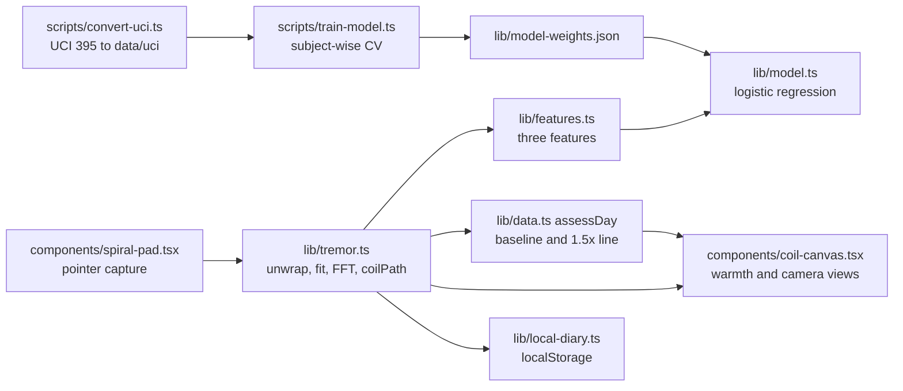

# Volutra

A person with Parkinson's draws a spiral on a phone or laptop in about 20 seconds, and Volutra measures the frequency and strength of their tremor in the browser. Readings line up against the dose time, so the hour each day when levodopa starts to wear off becomes a time on one chart that can go to the neurologist.

Live: https://volutra.vercel.app

Start at DEMO step 1: open `/`.

## Try it in 60 seconds

1. `/` shows today's six seeded spirals since the 08:00 dose as a clay coil. Pick 09:05, then 14:40: the coil is rebuilt from that drawing and runs hotter at 14:40, past today's line.
2. `/spirals/new`: draw a spiral with a finger, stylus or mouse. The result card gives the dominant frequency in Hz, the amplitude in mm and the spectrum, and your own coil turns on its side, coloured by your amplitude against today's 0.64 mm line.
3. `/spirals/uci-pwp-sst-07`: press Replay. A real 2017 tablet spiral from UCI 395 redraws at its own speed, the spectrum peaks near 5 Hz, and the camera eases from "As drawn" to "Side relief". Then press "Compare with my last drawing" to put your step 2 spectrum on the same chart.
4. `/activity`: the 08:00 dose, the 14:40 wearing-off band and the readings. Change the dose time and every mark is recomputed; print one A4 page for the neurologist.

| Address | Value |
| --- | --- |
| Live demo | https://volutra.vercel.app |

Recordings on the live URL: the site is deployed with `ADAPTER_MODE=real` and the committed proof run, so the line under the pad reads "Real recording: UCI 395 subject file ...". If the real adapter cannot load, the same line reads "Sample data: ..." and the `/spirals` header says stand-ins are shown.

## The problem

Levodopa, the main Parkinson's medication, fades between doses. Doctors call it wearing-off. To time doses better, a neurologist relies on the patient's paper on/off diary, filled in from memory. Check-ups come every three to six months, and a ten-minute clinic exam does not see the tremor that starts at 15:00 in the patient's kitchen.

Patients and carers can say "it gets worse in the afternoon". They cannot show a number or a time.

## The solution

Volutra turns a familiar clinical test, the Archimedes spiral, into a reading you can repeat many times a day:

1. The browser records the drawing as timestamped points using Pointer Events, including `getCoalescedEvents()` so fast devices report every sample, not just one per frame.
2. The spiral is unwrapped into polar coordinates and fitted to the ideal line `r = a + bθ` by least squares. What remains is the radial residual, the moment-by-moment wobble.
3. The residual is resampled to 100 Hz, detrended, Hann-windowed and run through a radix-2 FFT written in this repo (`lib/tremor.ts`). The tallest peak between 3 and 12 Hz is the tremor frequency. The RMS energy in that band is the amplitude in millimetres.
4. Each reading lands on a timeline keyed to the dose time. The first two readings at least 30 minutes after the dose set a personal baseline. The first later reading at 1.5 times baseline or more is marked as the point where the dose wears off.
5. A one-page printout and a CSV go to the next appointment.

Nothing is uploaded. All math runs in the tab and the diary lives in `localStorage`.

## How it fits together



## Key features

- **Spiral pad with live analysis.** Dominant frequency, band amplitude, spiral fit and the full spectrum within a second of lifting the pen. A warning appears if the device reports fewer than 30 points per second.
- **A coil that follows the measurement.** After a drawing, the 3D coil is rebuilt from your own points and its colour runs from olive to clay by your amplitude against today's seeded line; red heat appears only at or past the line.
- **Recording replay with a step-linked camera.** Any record redraws itself at the speed it was drawn. The coil is seen from above while it replays and turns to a side view when the result lands, so the tremor stands up as relief. "As drawn" and "Side relief" buttons do the same by hand.
- **Compare with your own drawing.** On a replay, one press draws the spectrum of the last spiral drawn on this device as an olive line on the same chart as the recording. With no drawing yet, the UCI control recording is drawn instead and labelled.
- **Dose day timeline.** Amplitude against clock time, the baseline, the 1.5x threshold, a shaded wearing-off band and an event history. Change the dose time and every mark is recomputed.
- **Doctor printout and CSV.** Print styles flip the palette to ink on paper.

## How it uses machine learning

The ML piece is a small, inspectable model rather than an API call. The same features the browser extracts (log band amplitude, share of power in the tremor band, distance of the peak from 5 Hz) feed a class-balanced logistic regression trained on the [UCI Parkinson Disease Spiral Drawings dataset](https://archive.ics.uci.edu/dataset/395/parkinson+disease+spiral+drawings+using+digitized+graphics+) (UCI 395, CC BY 4.0; the dataset page lists 62 people with Parkinson's and 15 controls). The output is shown as "resemblance to the dataset's Parkinson's group", always as a secondary signal.

How the pieces fit:

1. `scripts/convert-uci.ts` downloads the UCI 395 archive, reads the zip with `node:zlib` (no unzip dependency), keeps the static spiral test (Test ID 0) with the pen down, converts timestamps to seconds, finds each spiral's centre by a grid search that minimizes the Archimedes fit residual, and scales every file by one factor so the median outer radius matches the on-screen guide. Frequency does not depend on that scale; amplitude is approximate millimetres.
2. The same `lib/tremor.ts` pipeline that runs in the browser reads every subject's spiral, and `lib/features.ts` turns it into the three features.
3. `scripts/train-model.ts` runs 5-fold subject-wise stratified cross-validation (folds assigned by sorted file name, so the split is reproducible), reports balanced accuracy on the pooled out-of-fold predictions, refits on every subject and writes `lib/model-weights.json`.
4. The browser loads those weights, checks them with zod, and falls back to the hand-set provisional weights if the file does not parse.

Proof run results (written by `npm run proof`, never by hand):

<!-- PROOF:BEGIN uci-convert -->
UCI 395 converted on 2026-11-25: 61 Parkinson's and 15 control files with a static spiral test. Parkinson's replay `H_p000-0043.txt`: 142.1 Hz sampling, peak 5.76 Hz, band amplitude 2.02 mm. Control replay `C_0002.txt`: 142.1 Hz sampling, peak 5.19 Hz, band amplitude 0.04 mm.
<!-- PROOF:END uci-convert -->

<!-- PROOF:BEGIN model-cv -->
Subject-wise 5-fold stratified cross-validation over 61 Parkinson's and 15 control subjects: balanced accuracy 0.661 on the pooled out-of-fold predictions (trained 2026-11-25).
<!-- PROOF:END model-cv -->

<!-- PROOF:BEGIN tests -->
`npm test` on 2026-11-25: 10 passed, 0 failed.
<!-- PROOF:END tests -->

<!-- PROOF:BEGIN latency -->
`analyzeTrace` on the Parkinson's replay (1810 points): median 1.3 ms over 20 runs in Node on the proof machine.
<!-- PROOF:END latency -->

<!-- PROOF:BEGIN demo-path -->
Seed dose days on 2026-11-25, second dose window applied: 24 Nov: wearing-off at 14:40, 400 min after the 08:00 dose; 23 Nov: wearing-off at 15:10, 430 min after the 08:00 dose.
<!-- PROOF:END demo-path -->

**Honest status of this build:**

- The proof run is committed: `data/uci/manifest.json` holds two converted UCI 395 recordings and `lib/model-weights.json` holds weights trained with subject-wise cross-validation (the figure in the model-cv block above). The live site serves both when `ADAPTER_MODE=real`. With any other mode, or if the real adapter fails to load, the synthesized stand-ins and the seed diary are served instead, and the line under the pad and the `/spirals` header say so.
- A second dose closes the first dose's window: the baseline and the wearing-off mark only use readings from 30 minutes after the dose up to the next dose.
- The replay pick is disclosed, not hidden: the Parkinson's replay is the file whose spectrum peak is in 4 to 6 Hz with the highest band amplitude, and the control replay is the control file with the lowest band amplitude. The rule is also written into the manifest's `source` field. These are the clearest examples in the dataset, not typical ones.
- The 11 home spirals and the two dose days are synthesized from per-record parameters (`fixtures/seed-diary.json`), so every number on screen still comes out of the real pipeline.
- The model learns from Wacom tablet recordings. Finger and trackpad drawings come from a different distribution, which is why frequency and amplitude stay the primary output.

## Technologies

From `package.json`:

- Next.js 15 (App Router), React 19, TypeScript 5 in strict mode, Tailwind CSS 4
- three 0.187, @react-three/fiber 9 and @react-three/drei 10 for the 3D coil
- zod 3 for checking route ids, the converted recordings, the weights file and every localStorage read
- lucide-react icons and Radix Slot (`@radix-ui/react-slot`) for the button primitive
- tsx to run the conversion, training, proof and test scripts; tests use `node:test`

Written in this repo, with no library: the polar unwrap, least-squares fit, resampling, Hann window and radix-2 FFT (`lib/tremor.ts`), the logistic regression and its training loop, the SVG charts, Canvas 2D drawing with Pointer Events, and the print CSS. Deployed on Vercel.

## Target users

- People with Parkinson's on levodopa whose neurologist is adjusting dose timing
- Carers who keep the on/off diary for them
- Neurologists and Parkinson's nurses who want a dated, numeric record instead of a recollection

## Social impact

More than ten million people live with Parkinson's. For many of them, dose timing decides whether the afternoon is usable. Volutra needs no app install, no account and no special hardware, works in any modern browser, and keeps health data on the device. A clearer picture of when a dose fades can shorten the trial-and-error of adjusting it.

Volutra is a measurement diary, not a diagnostic tool.

## Prize tracks

This event has no sponsor bounty; one submission enters both ranked tracks automatically.

| Bounty | Prize | Slots | Required tech | Code file | DEMO step |
| --- | --- | --- | --- | --- | --- |
| 1st place | For the best project! | 1 | none stated | lib/tremor.ts, lib/model.ts, scripts/train-model.ts | 2, 3, 4 |
| Top 10 Finalists | For the top 10 finalists - Certificate awarded | 10 | none stated | same as above | 2, 3, 4 |

"Adaption credits for everyone" ("Use the following link to claim $1000 in Adaption credits!") is a credit link, not a judged track, and is not targeted.

Submission checklist: `DELIVERY.md` and `SUBMISSION.md`. Security notes: `SECURITY.md`. Source: https://github.com/mericcintosun/volutra

## Quickstart

```bash
npm install
npm run dev         # http://localhost:3000
npm test            # core pipeline tests (node:test)
npm run proof       # download UCI 395, convert the replays, train, rewrite the proof blocks above
npm run demo:reset  # put the seed diary back to the demo start state and check the real data is in place
```

**Storage.** There is no database and no server store. Readings saved from the drawing pad and any dose time you change are kept in this browser's `localStorage`, through one wrapper (`lib/local-diary.ts`) that checks every read with zod and starts empty if the stored data does not parse. The spectrum of the last drawing is kept under `volutra:last-spectrum:v1` for the compare view. Nothing leaves the device.

**Reset.** `npm run demo:reset` re-normalizes the seed diary and checks that the converted recordings and trained weights are in place. The browser side is cleared with the "Clear this device" button under the event history on `/activity` (or by opening a private window).

No secret is needed (see `.env.example`). `ADAPTER_MODE=real` serves the converted UCI recordings; anything else serves the seed stand-ins. `npm run build` produces the production bundle that Vercel deploys.

Routes:

- `/` overview of today's diary and the 3D coil
- `/spirals` every record, with filters and search
- `/spirals/[id]` one record, replayed and analysed; `/spirals/new` is the drawing pad
- `/activity` the dose day timeline, history, printout and CSV

## What we would build next

- A full verdict for the second dose window, with its own baseline and threshold on the same chart.
- A week view that shows whether the wearing-off hour drifts.
- Validation against clinician-rated tremor scores before any claim beyond "measurement diary".

## AI use

The hackathon rules state no AI-use policy. AI coding assistants helped write this code. The only model inside the product is the in-repo logistic regression: trained by `scripts/train-model.ts`, with its weights in `lib/model-weights.json`, run in the browser. No hosted model is called at any point.

## License

Code: MIT (LICENSE). Data: UCI Parkinson Disease Spiral Drawings Using Digitized Graphics Tablet, CC BY 4.0.
